# Blood Gear (PC Engine Super CD-ROM²) English translation v1.0

An unofficial fan translation patch. It contains only the changes to the game's
data tracks, not the game: you need your own disc image of **Blood Gear (Japan)**.

**[Download the patch (v1.0)](https://github.com/suddenlythis/bloodgearpce-english/releases/tag/v1.0)**
 · [How to install](INSTALL.md) · [Checksums](SHA1SUMS.txt)

  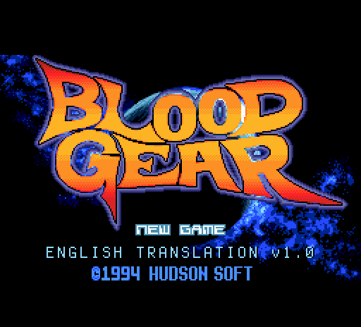

## Progress

| Area | Status | Details |
|---|---|---|
| English font and text system | Done | A new 8-pixel Latin font, and English stored compressed so that every area's script fits in the space its Japanese had |
| Dialogue | Done | 865 dialogue blocks across the game's seven areas and the title program |
| Menus and choices | Done | The command menu, Use / Drop, Yes / No, Repair / Upgrade, Buy / Sell, the choice rows in conversations |
| Names | Done | Items, weapons, shields, places, people and the eight chapter titles |
| System messages | Done | Save prompts and the backup-memory messages |
| Cutscenes | Done | All of the voiced cutscenes are subtitled: 24 scenes, about 19 minutes in total, appearing in different sections of the game as it progresses (the prologue, the opening and 22 story scenes) |
| Voice clips inside ordinary dialogue | Partly | One has text added. Seven short clips that the original plays with no text are still voice only |
| Tested on | Mednafen 1.32.1 | Not tested on other emulators or on real hardware |

Details are in [What is in English](#what-is-in-english),
[What was changed in the game](#what-was-changed-in-the-game),
[Not translated](#not-translated) and [Known issues](#known-issues) below.

## About the game

Blood Gear (ブラッド・ギア) is an action role-playing game for the PC Engine
Super CD-ROM².

| | |
|---|---|
| Released | 28 October 1994, Japan only |
| Publisher | Hudson Soft |
| Developer | Westone, with RED (the opening credits read "In association with Westone, RED") |
| Product code | HCD4048 |
| Directed by | Kohta Kikuchi |
| Game design | Yutaka Hirata, Tsutomu Watanabe |
| Written by | Yutaka Hirata |
| Character design | Mora Okamora |
| Mechanical design | Kazunori Nakazawa, Boku Kubo, Hidewo Nakazima |
| Music | Jin W. |

The staff names are spelled as the game's own opening credits spell them.

It was never released outside Japan, and as far as I could find it had no
English translation before this one.

**The story.** Fifteen years ago an armed nation calling itself the Degner Empire
appeared on Euro, third planet of the Eta system, and overran its city-states
with war machines called Powered Gears. Aref is the son of a scientist working
for the Revolutionary Army. When the Empire raids the laboratory and takes the
Garzhardt, the Gear his father built, a dying assistant brings Aref the one thing
that got out: the Arms, a device that links a Gear to its pilot's mind, and that
has killed nearly everyone who has worn it. Aref puts them on.

**How it plays.** Towns are seen from above: you talk to people, repair and
upgrade your Gear at a workshop, and buy weapons and shields. Between towns are
side-scrolling action stages, fought in the Gear with a melee weapon, a ranged
weapon and a shield. Money from fallen enemies goes into eight upgradeable stats.
The story is told through conversations and through voiced picture scenes.

**The Aurail connection.** Westone made an arcade shooter called Aurail, released
by Sega in 1990. Blood Gear shares its world: the planet Aurail and its people are
part of this game's story. Wikipedia's article on Aurail reports that Blood Gear's
ending credits call it "Aurail Scenario 2", and also that Westone co-founder
Ryuichi Nishizawa said in a 2012 interview that it is not a sequel. I have not
verified either statement myself.

Sources: the game's own credits, [Redump](http://redump.org/disc/36834/) for the
disc, the review at [pcengine.co.uk](https://pcengine.co.uk/HTML_Games/Blood_Gear.htm)
for how it plays, and [Wikipedia on Aurail](https://en.wikipedia.org/wiki/Aurail).

## Screenshots

| | |
|---|---|
| 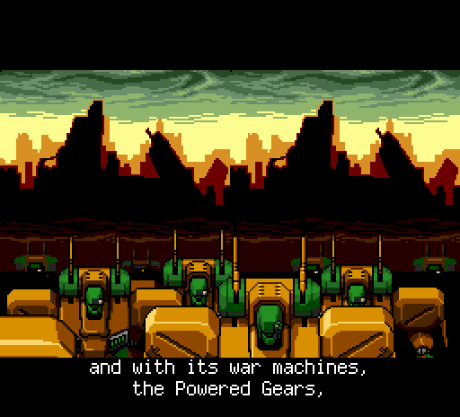 | 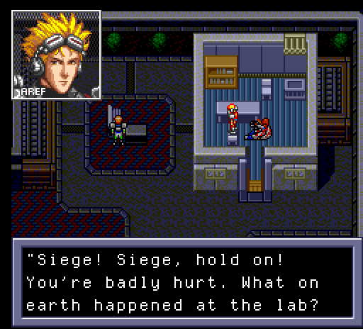 |
| 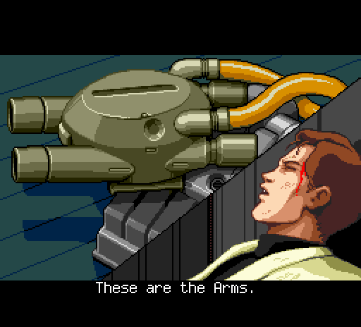 | 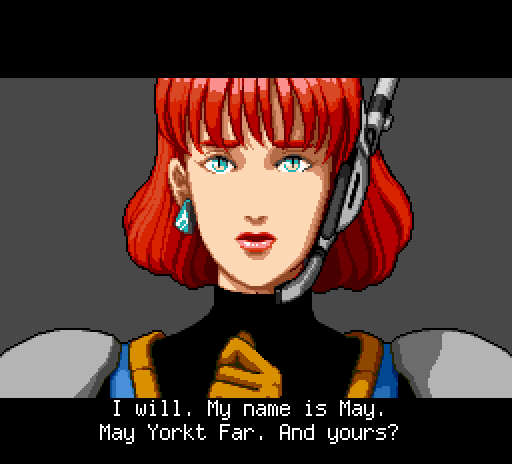 |
| 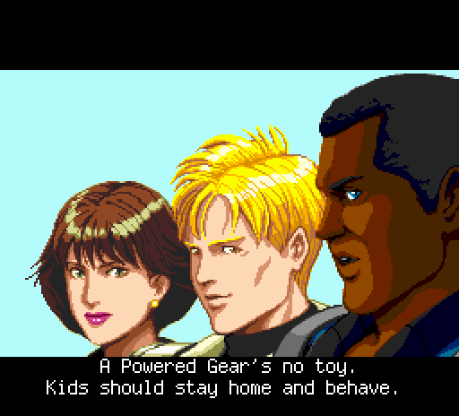 | 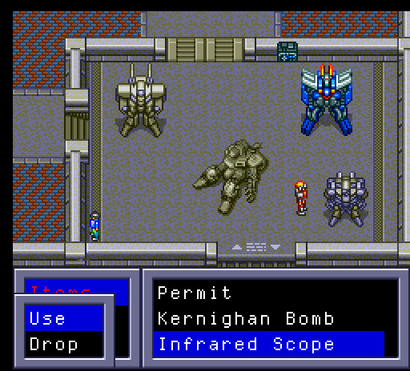 |
| 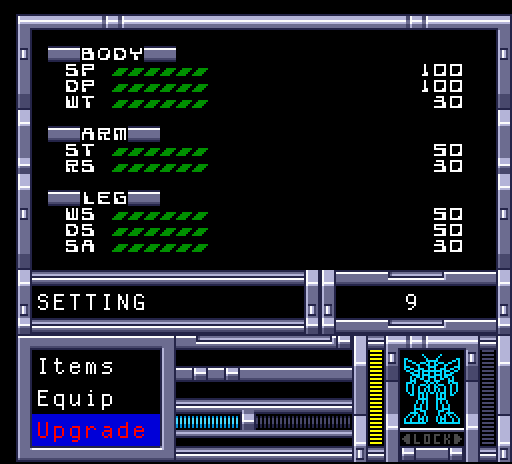 | 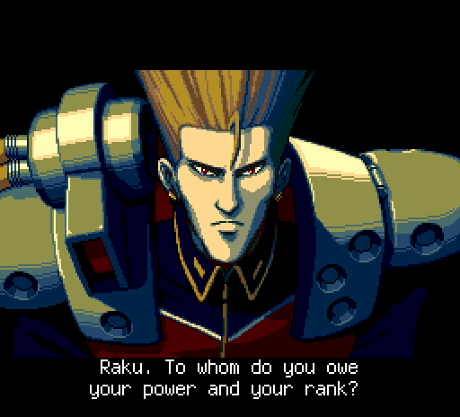 |
| 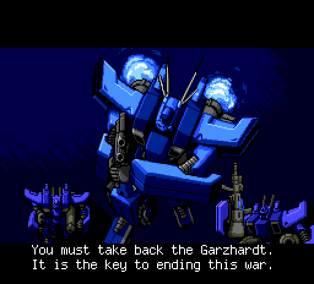 | 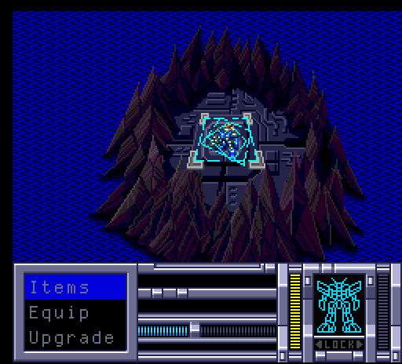 |
| 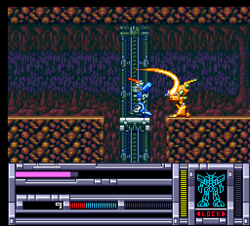 | 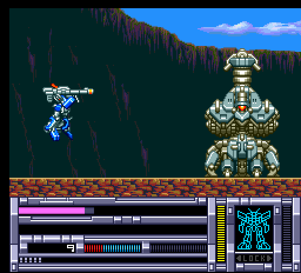 |
| 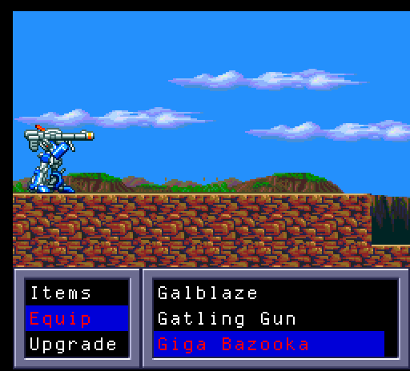 | 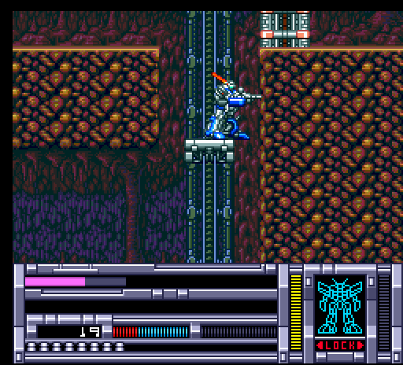 |
| 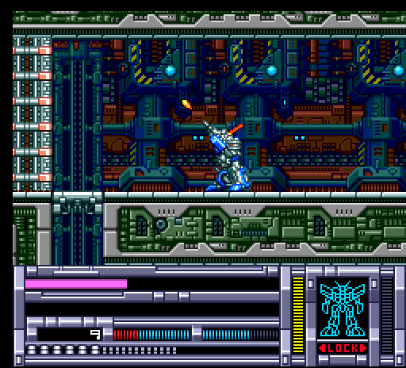 |  |

## Installing

Short version: patch **Track 02** and **Track 45** of your disc image with the two
`.xdelta` files, keep the file names, and open your usual `.cue`.

Full instructions, with the checksums to verify your image and the result, are in
[INSTALL.md](INSTALL.md).

Start a new game or boot fresh after patching, rather than loading a save state
made on the Japanese game.

## About this translation

The script was translated from the game's own Japanese text. The aim was a
natural, faithful localization, and names are kept as the game gives them.

Names. Where the game itself writes a name in Latin letters, that spelling is
used. The main character's name is Aref in this translation because that is how
the developers wrote it in English themselves: his portrait card in the game
reads AREF.

AI was used to assist with the code and translation.

## What is in English

- All dialogue: townspeople, story events, shops, workshops and battles.
- Menus: Items / Equip / Upgrade, Use / Drop, Yes / No, Repair / Upgrade,
  Buy / Sell, Cancel, and the choices offered in conversations.
- Item, weapon and shield names (62), with the kind words the game adds to them
  (Unit, Gun, Sword, Rifle, Bazooka, Pod, Shield).
- The eight chapter titles shown between story parts.
- Save prompts and the backup-memory messages.
- Subtitles for all of the voiced cutscenes: the prologue narration, the opening
  and the 22 scenes of the story. That is 24 cutscenes with a total running time
  of about 19 minutes, drawn in time with the voices. They
  are spread through the game and appear in its different sections as the story
  progresses. One more short scene and the ending sequence have no speech, so
  there was nothing in them to subtitle.
- Text for one voice clip that the original plays with no text at all.

## What was changed in the game

Text alone would not fit: Japanese says more per character, and each area has a
fixed amount of room for its script. So besides the words, the patch changes how
the game stores and draws them. Nothing about the rules, the story, the
difficulty or the content was changed.

Text storage
- English is stored compressed: each area has a dictionary of its most common
  words and phrases, built for that area's script.
- The game's text routine now reads English and still handles the few places
  that draw the original's Japanese characters.

Font
- A new 8 x 10 Latin font (capitals, lowercase, digits, punctuation) replaces
  the kanji font for dialogue. Two letters are drawn in the space one Japanese
  character took.
- Numbers are drawn with the same digits in both of the game's fonts.

Menus
- The third row of the command menu reads "Upgrade": the natural word was one
  letter too wide for the box.
- Menu rows that are redrawn when the cursor moves are padded to the width of
  the Japanese they replace, so nothing shows through.

Subtitles for the picture scenes
- The pictures are letterboxed: the game shows 160 lines of the screen. While a
  line is spoken the patch opens a band of 24 more lines under the picture and
  draws up to two lines of 40 letters there. The picture itself is not covered.
- The letters are sprites. Video memory is nearly full during these scenes, so
  the subtitle program borrows a small amount of it for each line, saves what
  was there, and puts it back afterwards.
- Lines spoken over a blanked screen are shown too.

Title screen
- The line "ENGLISH TRANSLATION v1.0" was added between NEW GAME and the
  copyright line.

One thing that is the same as the original on purpose: spoken lines open with a
quotation mark and do not close it. The Japanese does exactly this, using the
opening mark to show that someone is speaking.

## Not translated

- Seven short voice clips that the original plays in the middle of ordinary
  dialogue with no text on screen. They are still voice only.
- One four-second voiced line whose place in the game was not found.

## Known issues

- A subtitle can potentially blink for a frame or two when the picture behind it
  changes.
- Four of the shields are all called just "Shield", as in the Japanese.
- "Hand Gun" and "Shot Gun" appear as two words: the game builds a weapon's name
  from a model word and a kind word.

## Technical

- Two files of the disc image are changed: Track 02, the game data, and Track
  45, a second copy of the data that the console falls back on if it cannot
  read the first. Both get the same changes (186 sectors each). The 43 audio
  tracks are untouched.
- The patched tracks are the same size as the originals, and sector
  error-correction data is recomputed for every changed sector.
- The patches are made against the Redump image and refuse any other file.
- Save states made on the Japanese game or on an older build keep their old text
  until the game loads that area again. The picture scenes work from such a
  state. In-game saves are not affected.
- Tested on Mednafen 1.32.1. Not tested on other emulators or on real hardware.

## Version history

| Version | Date | Notes |
|---|---|---|
| v1.0 | 2026-11-16 | First release. Full script, menus, names, system messages, subtitles for all 24 voiced cutscenes (about 19 minutes), version line on the title screen |

---

This is an unofficial, non-commercial fan work. Blood Gear and everything in it
belong to their owners. The patch contains no game data that can be used without
an original disc image.
